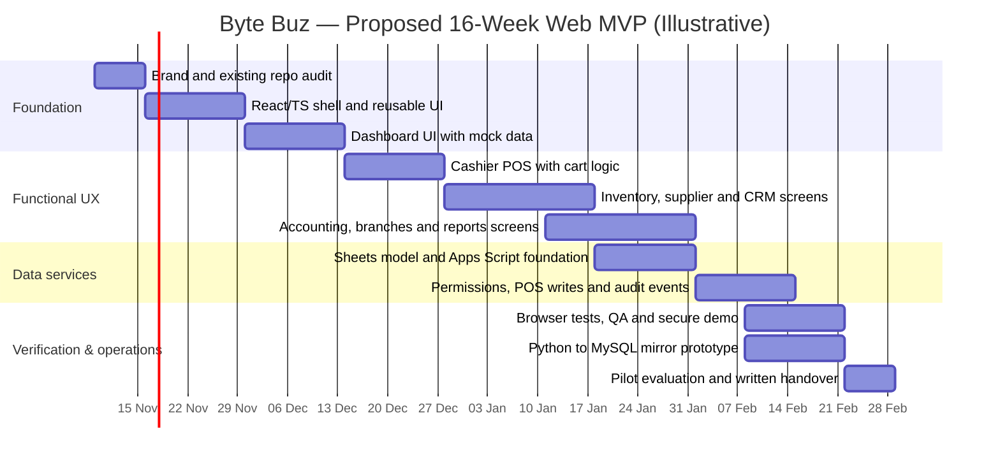
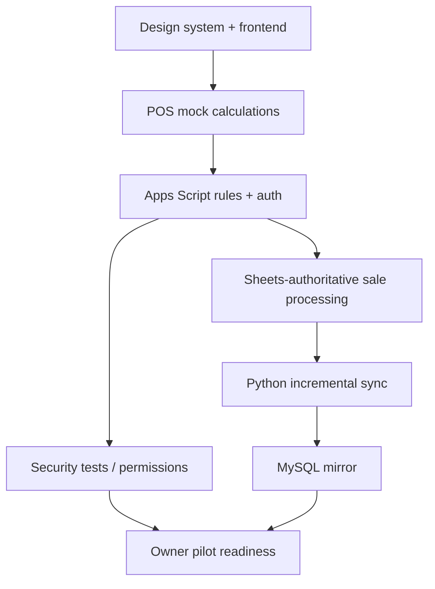

# 06 · Proposed Byte Buz Development Roadmap & Gantt

[← Project home](./README.md) · [Architecture](./SYSTEM-ARCHITECTURE.md) · [Feature map](./FEATURES-AND-SCREENS.md)

> [!IMPORTANT]
> **Planning illustration, not an agreed delivery contract.** The earlier Byte Buz Master Prompt v1.0 defines **27 implementation phases (0–26)** but **does not give approved calendar dates, cost totals or verified percentages complete**. The **16-week** schedule (9 November 2026–28 February 2027) below is an editorial example for sequencing web-MVP work; obtain team-approved estimates and milestones before calling it a committed release plan. Flutter mobile remains later-phase work.

## Source-confirmed phase groups

| Phase group | Original numbered steps | Major outcomes |
| :--- | :--- | :--- |
| Brand, scaffold and UI shell | 0–5 | Repo, React/TS, theme, auth shell, routing, dashboard mock UI |
| Working POS and application features | 6–10 | POS cart, inventory, customers, accounting, remaining screen areas |
| QA and static deployment | 11–13 | Unit/browser tests, GitHub Actions, Pages mock-data frontend |
| Online service foundation | 14–20 | Google Sheets data model, Apps Script API, roles, sales, reports and audits |
| Sync, mirror and hardening | 21–24 | Python job, MySQL mirror, reconciliation, monitoring |
| Owner mobile | 25–26 | Mobile requirements and Flutter owner application (later stage) |

## Illustrative 16-week MVP Gantt

**The dates above are suggested, not taken from the original source or verified development status.** The chart intentionally allows overlap; workload and resources have not been validated. It is not a promise of a production payment system.

## Milestone gates

| Gate | Evidence needed | Current public status |
| :--- | :--- | :--- |
| G1 · Visual foundation | Dashboard renders and is compared with reference | Not verified here |
| G2 · Safe POS demonstration | Cart logic, tax/discount calculations, duplicate-sale tests | Not verified here |
| G3 · Core business modules | Inventory, purchases, customers and staff journeys tested | Not verified here |
| G4 · Initial authorized API | Auth, role/branch permissions and backend-validation tests | Not verified here |
| G5 · Data mirror | Python sync checkpoints and MySQL upserts reconciled | Not verified here |
| G6 · Owner review | Product walkthrough, risks, documentation and pilot sign-off | Not verified here |

## Core dependencies

## Release principles

Never treat screenshots as an implemented system, fake data as business figures, or a mirror as a second authoritative ledger. Preserve protected source repos and consult the owner before changing business calculations, stored data, permissions or payment behavior.

[← Project home](./README.md)
