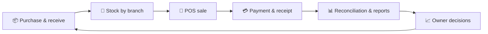
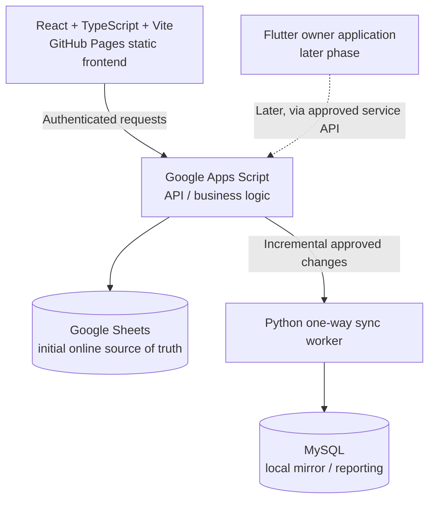

# 📊 Byte Buz
### Business Management & Point-of-Sale Platform

**Retail operations · Multi-branch inventory · Sales · Accounting · Analytics**

**Beyond Code. · Innovation for Africa.**

[Explore Modules](./FEATURES-AND-SCREENS.md) · [Architecture](./SYSTEM-ARCHITECTURE.md) · [UI Showcase](./DESIGN-SHOWCASE.md) · [Roadmap](./GANTT-CHART.md)

> [!IMPORTANT]
> **Public product documentation, not a claim of a deployed commercial service.** The interface examples are owner-supplied concept screens containing illustrative business names, financial figures, dates and personal details. They do not establish actual sales, customers, suppliers or operating results. The Byte Buz application repositories are private and remain unchanged.

## Executive summary

**Byte Buz** is a planned commercial **web-first business management and point-of-sale platform** created for retail shops and small-to-medium businesses, initially in Uganda. The vision combines cashier sales, inventory control, procurement, accounting, staff access, customer relationships, branch oversight, security auditing and analytical reporting in one coordinated business environment. A **Flutter owner mobile application** is a later phase.

### The operational cycle

## Documentation library

| No. | Section | Content |
| :---: | :--- | :--- |
| **01** | **[Product Scope](./PROJECT-SCOPE.md)** | Business goals, personas, approved brand, stage and boundaries |
| **02** | **[20 Screens & Features](./FEATURES-AND-SCREENS.md)** | Approved application page routes and major business capabilities |
| **03** | **[Technical Architecture](./SYSTEM-ARCHITECTURE.md)** | React/TypeScript, Apps Script, Google Sheets, Python and MySQL mirror |
| **04** | **[Operational Workflows](./WORKFLOWS-AND-CONTROLS.md)** | Cashier sale, stock movements, procurement, till closing and security |
| **05** | **[Design Showcase](./DESIGN-SHOWCASE.md)** | Owner-supplied UI image register, screen groups and design standards |
| **06** | **[Roadmap & Gantt](./GANTT-CHART.md)** | Proposed delivery baseline, dependencies and acceptance gates |
| **07** | **[Asset Publication Guide](./assets/UPLOAD-GUIDE.md)** | Exact screenshot and logo filenames for GitHub publishing |

## Product capabilities

| Area | Main purpose | Example evidence in supplied screens |
| :--- | :--- | :--- |
| 🛒 Sales / POS | Product search, cashier cart, payment and receipt | Sales analytics, business-day control |
| 📦 Inventory | Product intelligence, branches, stock movements and alerts | Riham sugar product detail |
| 🚚 Procurement | Supplier profiles, purchase orders and receiving | Mukwano Group supplier profile |
| 🎯 Promotions | Customer segments, discount campaigns and loyalty | Promotions & Loyalty |
| 🏬 Branches | Branch comparisons and stock-transfer suggestions | Branch Performance |
| 💰 Accounting | Expenses, payments, reconciliation and profit reports | Business-day / analytics examples |
| 👥 Staff | Roles, attendance, performance and flagged actions | Staff Performance |
| 🔐 Audit & sync | Permissions, event logs, backups and integrity checks | Alerts and operational controls |

## Source-derived technology strategy

This is the **agreed initial design direction** recorded in the Byte Buz Master Prompt v1.0. It is not a statement that all components are running. Google Sheets is an initial MVP store, **not the permanent database architecture**. A later migration to Node.js or PHP and hosted MySQL is contemplated in the source guidance.

## Public project status

| Item | Current treatment |
| :--- | :--- |
| Source-of-truth design brief | Located in prior project materials; original not republished |
| Screen design references | Eight new reference assets supplied in this conversation |
| App code repositories | Exist separately and are **private** |
| Working production deployment | Not independently verified here |
| Screens, sales, ratings, stock figures | **Mockup values only**, not live performance |
| Proposed schedule | Relative **16-week editorial planning example**, pending owner validation |
| Public source code / secrets | Not disclosed |

## Branding and ownership

**Owner:** ByteLab Uganda Ltd · **Founder:** Gyagenda Peter Katabalwa (Code Therapist)  
**Brand:** Deep/royal blue, modern red, white-first dashboards with a cloud / POS attendant / business-growth emblem.

[ByteLab Uganda](https://bytelabug.com/) · [Code Therapist GitHub](https://github.com/codetherapistpita-oss) · [Knowledge Hub](../../README.md)

The information here is a public-safe technical interpretation of existing Byte Buz project materials. No raw master prompt, secrets, customer data or private application source code is included.
