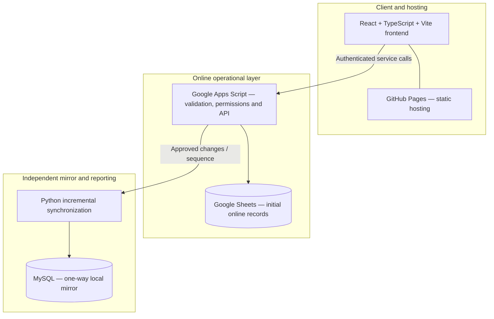
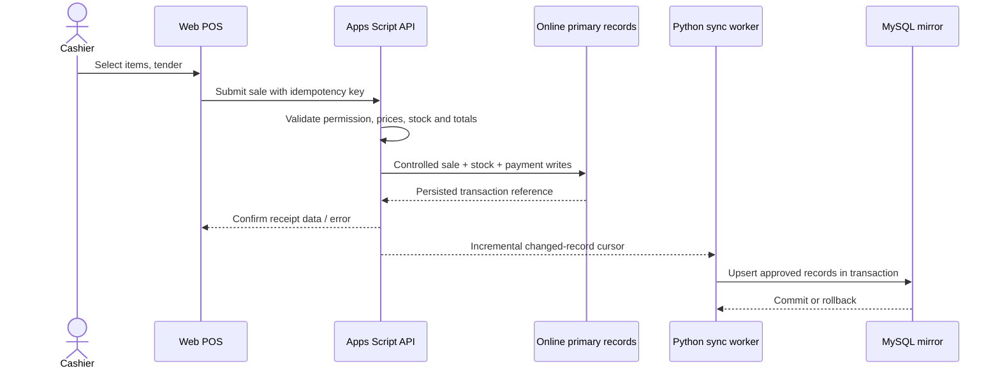
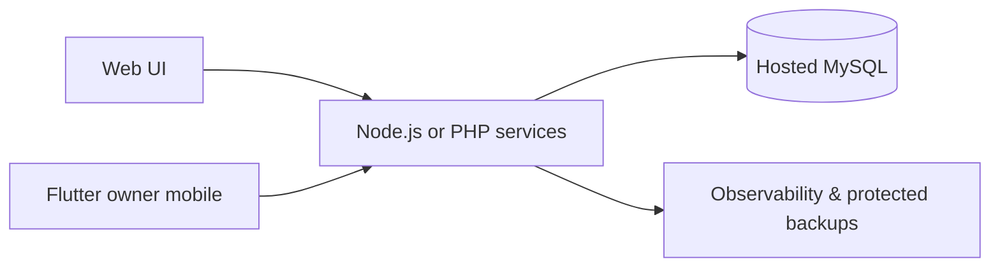

# 03 · Technical Architecture & Data Ownership

[← Project home](./README.md) · [Modules](./FEATURES-AND-SCREENS.md)

## Confirmed early-stage architecture from the owner brief

**Important architectural separation:** Apps Script is the application logic/API layer; **Google Sheets is the initial data source of truth**, and MySQL initially provides a *one-way replica*, not a second independent writer. The product brief anticipates eventual Node.js or PHP + hosted MySQL migration after a controlled redesign of backend persistence and services.

## Financially sensitive workflow

The sequence is an **intended design**, not proof that Google Sheets can provide database-grade atomic transactions across arbitrary writes. For the initial MVP, use Apps Script locks, idempotent operations and reconciliation to limit concurrency errors, and test failure cases. **High-volume or multi-register financial operation would require stronger persistence guarantees before production use.**

## Rules that must survive any backend migration

| Data domain | Key invariant |
| :--- | :--- |
| Sales | Unique ID, authoritative calculation, duplicate prevention |
| Inventory | Controlled movement ledger; no silent balance changes |
| Payments | Explicit settlement/refund records; accurate reconciliation |
| Roles | Per-business and per-branch permission enforcement |
| Audit | Append-oriented sensitive-action history |
| Sync | Stable IDs, checkpointed sequence, safe retry and idempotent upsert |
| Customer | Permissioned access and separate marketing consent |

## Later evolution — anticipated, not selected as active production stack

The private web/backend/mobile repositories remain outside this public technical guide. No credentials, proprietary code, or real customer data are reproduced.

[← Project home](./README.md)
