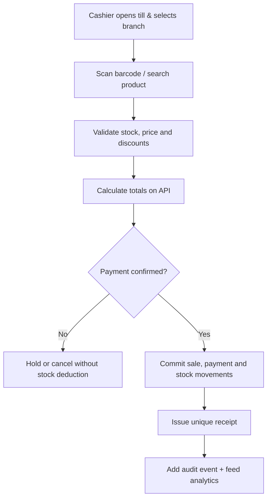
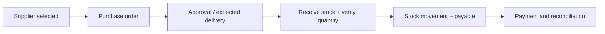
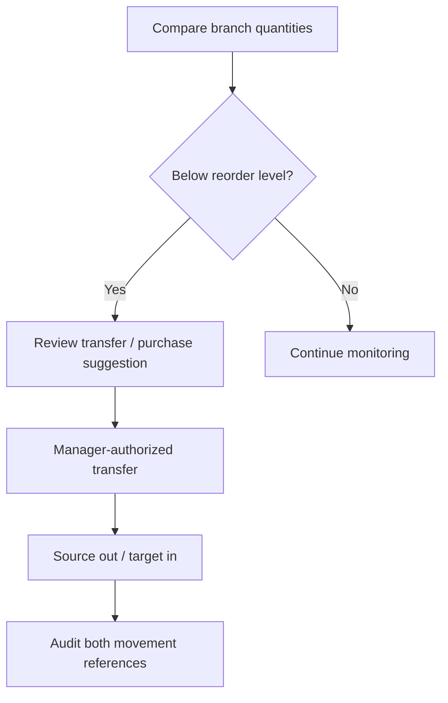
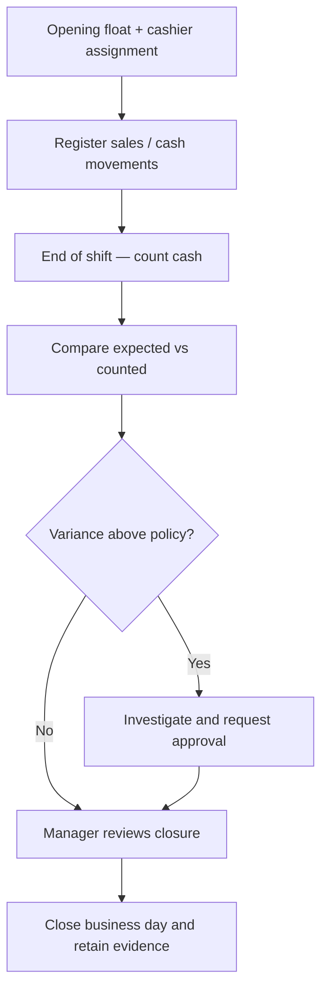

# 04 · Operational Workflows & Business Controls

[← Project home](./README.md) · [Technology](./SYSTEM-ARCHITECTURE.md) · [Designs](./DESIGN-SHOWCASE.md)

## Sale → Stock → Payment → Receipt

**Protection:** Unique sale ID and idempotency key, server-side stock checks, safe money arithmetic and recorded cancellation/refund operations.

## Supplier → Purchase Order → Goods Receipt

Changes to stock must be traceable: receipts add inventory; sales subtract it; transfers produce an outflow at the source branch and an inflow at the destination; adjustments require reasons.

## Branch management and stock redistribution

Recommendations are support for a manager, not an autonomous transfer of stock.

## Daily till control

Cash variances and exceptions must remain in the accounting and audit records. The mock screen's sample sales/cash numbers are not real transactions.

## Customer rewards and promotions

Marketing consent is separately recorded. Campaigns set an approved audience, eligible products, date window, discount limits, redemption policy and responsible approver. All discounts are recorded against relevant sales for reporting.

## Control matrix

| Control | Required business behavior |
| :--- | :--- |
| Price override | Authorized role, reason, previous/current value, audit event |
| Refund | Original receipt link, condition, approval threshold, reversal record |
| Stock adjustment | Reason, branch, user, signed movement and audit |
| Manual sync | Privileged action with job ID, time and outcome |
| Backup restore | Owner-approved and logged |
| Supplier suspension | Role check, rationale and status history |

[← Project home](./README.md)
