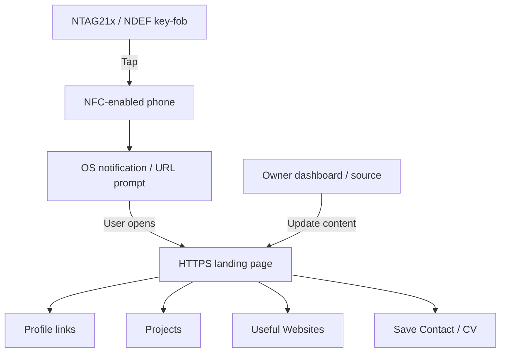

# Byte IoT Tap — Architecture & Workflow

## Data boundary
The NFC tag contains a short URL only. Profile details live on the web page. This allows content to change while the physical tag remains unchanged.

## Suggested URL model
`https://bytelabug.com/tap/peter` or a controlled equivalent.

## Security
- Do not store passwords, tokens or private identifiers on the tag.
- Use HTTPS.
- Validate outbound links.
- If analytics are added, disclose them and avoid unnecessary personal tracking.
