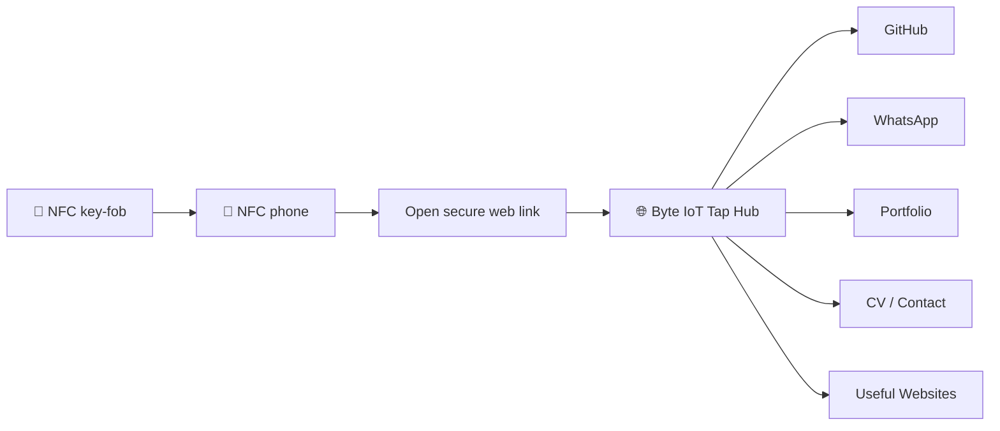

# 🔗 IoT Project 01 — Byte IoT Tap
### Tap. Connect. Explore.

**NFC key-fob → Phone → Personal Digital Hub → User-selected destination**

## Executive summary

**Byte IoT Tap** is a portable NFC digital-identity and resource-sharing concept. A small key-fob/tag stores one controlled HTTPS URL. When an NFC-enabled phone reads the tag, the phone offers to open a mobile landing page containing selected links such as Portfolio, GitHub, WhatsApp, LinkedIn, CV, ByteLab, projects and curated useful websites.

The tag stores **the URL, not the full profile**. The web page can therefore be updated at any time without replacing the physical tag.

## Main user journey

## Recommended credential

Use an **NDEF-capable NFC tag**, ideally **NTAG213/215/216** for a standard smartphone URL experience. Do not assume every generic 13.56 MHz RFID key-fob is NFC Forum/NDEF compatible; verify the exact chip before purchase.

## Documentation

- [Software Requirements Specification](./SRS.md)
- [Architecture & Workflow](./ARCHITECTURE.md)
- [Gantt Roadmap](./GANTT.md)
- [Prototype Quotation](./QUOTATION.md)

## Prototype status

Concept and documentation baseline. No production service or public-user platform is claimed yet.

[← Byte IoT family](../README.md)
