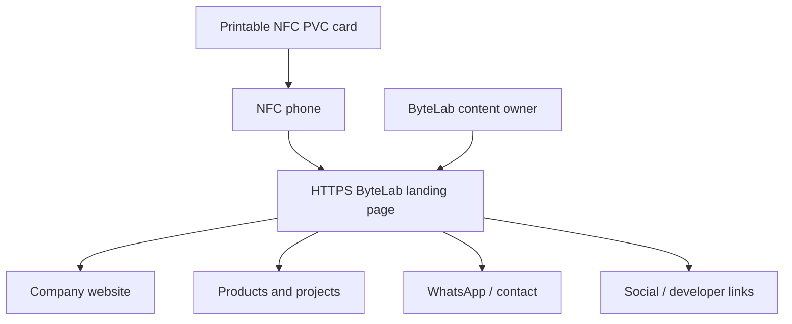

# ByteLab Smart Card — Architecture & Workflow

## Card-data rule
Store only the URL and minimal metadata needed for the tap experience. The company page remains the source of truth.

## Chip guidance
- **Public web-card use:** NTAG213/215/216 or equivalent NDEF-capable NFC Forum tag.
- **Protected access use:** DESFire-class credential with server-side authorization.
