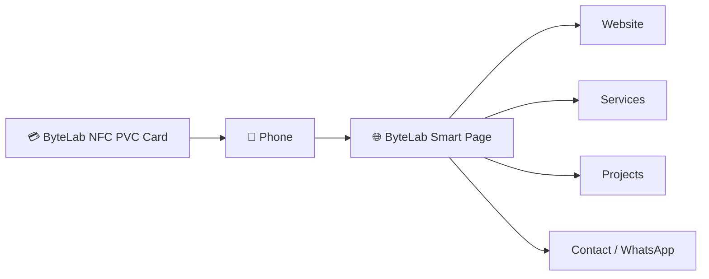

# 💳 IoT Project 02 — ByteLab Smart Card
### One physical ByteLab card · One controlled digital company entry point

## Executive summary

**ByteLab Smart Card** is a printable NFC PVC card carrying ByteLab branding. A phone tap opens a controlled ByteLab landing page containing the company website, services, projects, verified contact channels and other approved public resources.

For a simple phone-tap web card, the preferred chip family is **NDEF-capable NTAG21x**. A DESFire-class card is justified only when the project expands into authenticated access or protected applications.

## Documentation
- [SRS](./SRS.md)
- [Architecture & Workflow](./ARCHITECTURE.md)
- [Gantt](./GANTT.md)
- [Quotation](./QUOTATION.md)

[← Byte IoT family](../README.md)
