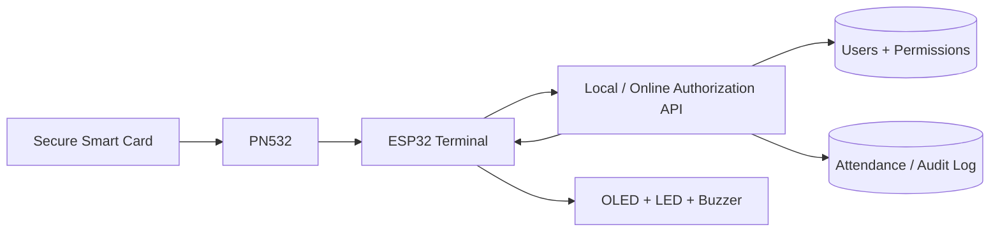

# 🚪 IoT Project 03 — Byte IoT Access
### Smart card access and attendance for a controlled lab or office prototype

## Executive summary

**Byte IoT Access** extends the Byte IoT family from public-information NFC tags into authenticated edge computing. An ESP32 terminal uses a PN532 reader to verify a smart credential against a local or online authorization service, display a decision and record an audit event.

The first prototype is intended for an **authorized lab/office test environment**, not for bypassing or controlling third-party security systems.

## Documentation
- [SRS](./SRS.md)
- [Architecture](./ARCHITECTURE.md)
- [Gantt](./GANTT.md)
- [Quotation](./QUOTATION.md)

[← Byte IoT family](../README.md)
