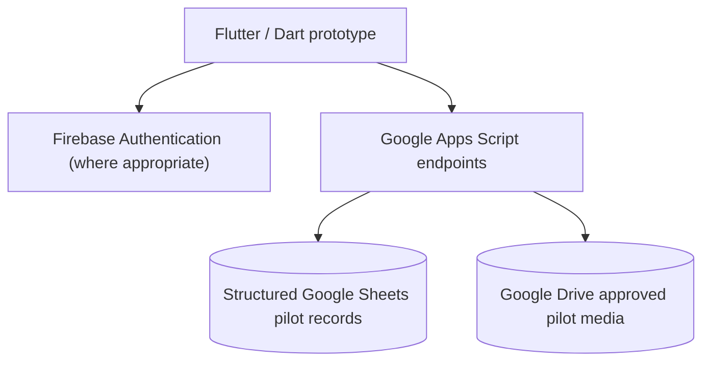
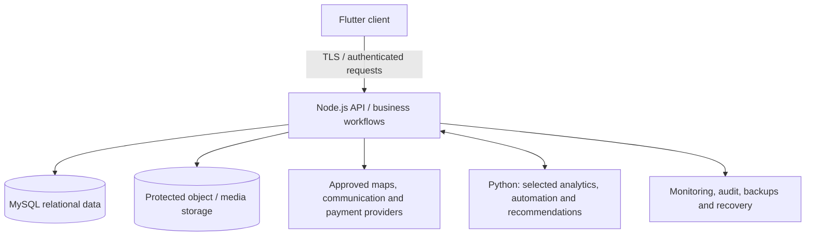
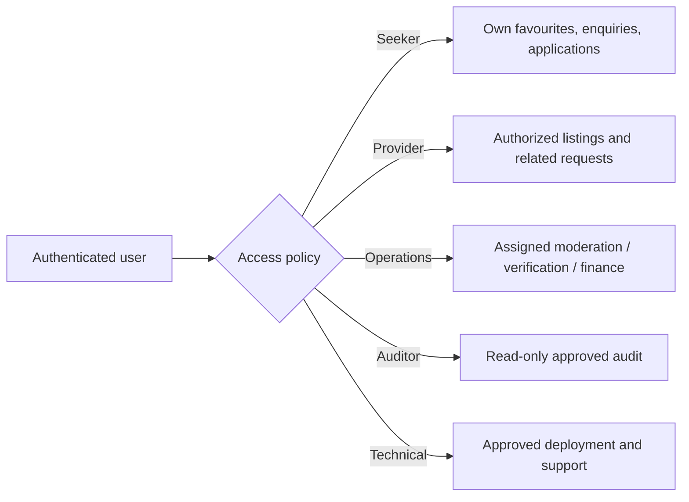
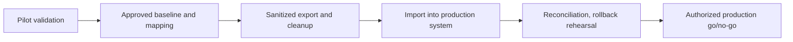

# 🏗️ ByteRent — Proposed System Architecture

[← Project home](./README.md) · [Security & quality](./TRUST-AND-QUALITY.md)

## Stage 1 · Controlled pilot

The proposal and SRS describe a limited user-validation stage:

**Boundary:** This is for **small approved pilot use**, not high-volume operation, unrestricted document storage or a durable financial ledger.

## Stage 2 · Proposed full production

Production requires protected service authorization, durable data, media access controls, proper transaction states, recovery exercises and capacity planning. No specific payment, hosting or maps vendor is asserted as already contracted.

## Role and authorization boundaries

**Authentication is not authorization.** The service must check role, organization and record ownership on each protected operation. Staff should use named accounts and least privilege.

## Proposed high-level data entities

| Entity | Purpose |
|---|---|
| User & provider organization | Identity, approved role, contact/preferences |
| Property listing | Type, location, fees, owner/provider reference and state |
| Listing media | Approved photographs and evidence status |
| Availability | Date/rental availability and booking constraints |
| Enquiry / appointment | Questions, viewing slots and status |
| Application / booking | Documented action with state transitions |
| Payment transaction | Approved provider reference, receipt and reconciliation state |
| Verification / fraud case | Evidence review, moderation, outcomes |
| Audit event | Security-sensitive action and actor/time |

This table is an **explanatory summary of the requirements**, not the complete confidential production schema.

## Migration concept

The production service and its data model supersede Apps Script/Sheets for authoritative national operations; stable identities and documented interfaces support migration.

[← Project home](./README.md)
