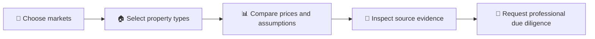
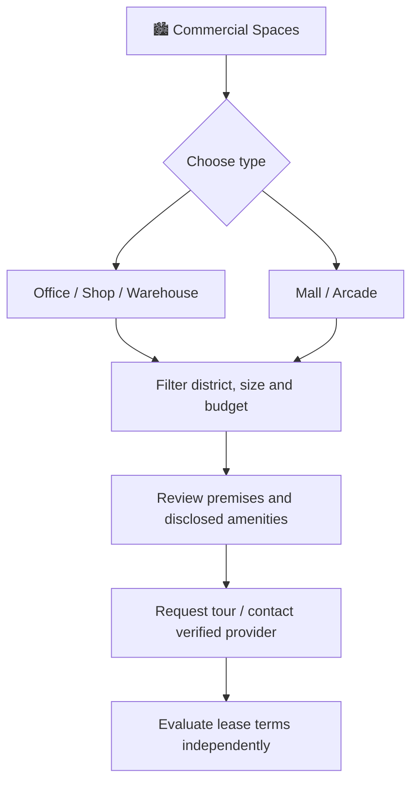
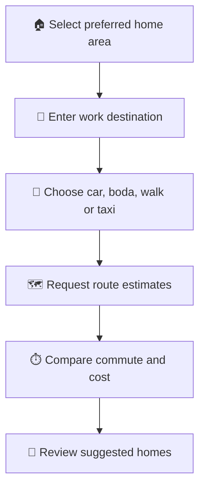
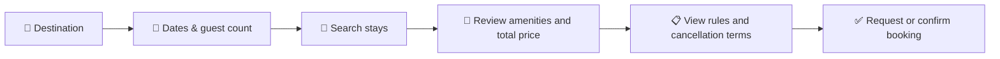
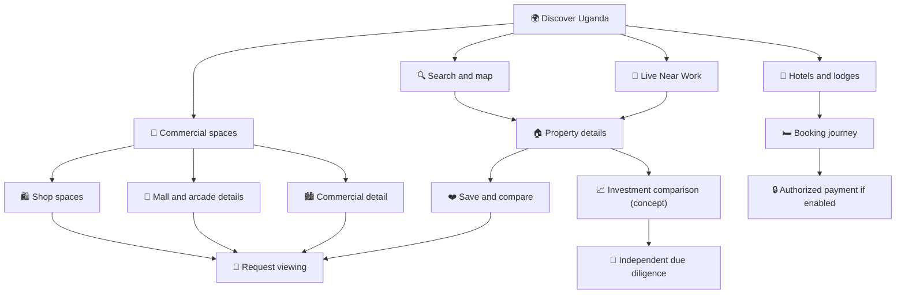

# 🎨 ByteRent Uganda — Original Screen Showcase

<strong>Beyond Listings. Find Home.</strong> Location-first discovery · Property details · Commercial spaces · Comparison · Booking

> [!IMPORTANT]
> **Concept screens — not a live property marketplace.** These mockups were supplied by the ByteRent project owner. Sample property names, pricing, “verified” badges, ROI estimates, demand scores, agent identities, phone numbers, maps and booking states are **illustrative design content**. No investment returns, ownership, property availability or provider verification is being promised.

> [!NOTE]
> **Asset publishing status:** The layout and image paths below are ready, but the owner-supplied original PNGs have **not yet been uploaded to GitHub**. Until they are committed to `assets/original/`, some images below will display as missing. The byte-for-byte original images are provided in a separate upload package. The existing original public vector previews remain available in [the assets directory](./assets/).

## 01 · Brand identity

<table>
<tr><td width="68%" align="center"><strong>Original landscape logo</strong> </td><td width="32%" align="center"><strong>Original portrait logo</strong> </td></tr>
</table>

The supplied logo identity emphasizes **Byte** (blue), **Rent** (red), a property/cloud/map-pin emblem, and **“Beyond Listings. Find Home.”** The interface combines midnight navy surfaces, bright blue secondary actions, red primary actions and white typography.

## 02 · Quick visual navigation

| Collection | Screens | Why it matters |
|---|---|---|
| [Investment intelligence](#03--property-investment-comparison) | Investment Compare | Concept for side-by-side property investment discovery |
| [Commercial real estate](#04--commercial-property-experience) | Commercial Details, Mall & Arcade, Shop Spaces | Different journeys for office/shop/mall inventory |
| [Location intelligence](#05--live-near-work) | Live Near Work | Commute-aware residential search |
| [Hospitality](#06--hotels--lodges) | Hotels & Lodges | Accommodation discovery and browsing |
| [End-to-end workflows](#07--how-these-screens-connect) | Diagrams below | Show relationships from search to enquiry |

## 03 · Property investment comparison

**What the concept shows:** Land, apartments, shops and office units in separate comparison cards; illustrated estimated ROI, demand scores, rental potential and growth indicators; plus a comparison overview chart.

**Design direction:** Every displayed metric should have a visible methodology, data date and uncertainty range before release. An attractive score is not investment advice or a guaranteed return.

## 04 · Commercial property experience

<table>
<tr><td align="center" width="50%"><strong>Commercial property details</strong> </td><td align="center" width="50%"><strong>Mall & arcade details</strong> </td></tr>
<tr><td align="center">Space area, utilities, parking, agent contact and viewing requests.</td><td align="center">Units, transport access, amenities and contact/tour actions.</td></tr>
</table>

### Shop spaces by neighbourhood

The mockup demonstrates category filters such as shop, salon, electronics, boutique, pharmacy and mini-market, plus a location-aware property list.

**Product requirement:** commercial inventory needs **type-specific** fields; generic residential-room fields are not sufficient for business property decisions.

## 05 · Live Near Work

This visual proposes searching homes by the commute to a work destination, with selectable transport modes, predicted travel times and ranked homes.

**Accuracy requirement:** route durations, traffic labels and distances should be presented as estimates from an authorized mapping service with appropriate date/context. The sample times visible in the screen are mock data.

## 06 · Hotels & Lodges

The accommodation visual features cards with images, price-per-night, guest ratings, amenities and booking prompts. These visual ratings and offers are examples, not verified hospitality inventory.

## 07 · How these screens connect

The following map links the **actual supplied screen categories** to a public explanation of the product architecture:

### Example screen-to-requirements traceability

| Visual | Related module | Research / engineering questions |
|---|---|---|
| Investment comparison | Analytics and saved comparisons | Source data, ROI model, reliability and disclosures |
| Commercial details | Commercial listings | Floor area, road access, utilities, business suitability |
| Arcade details | Multi-unit premises | Unit availability, tenant/provider rights |
| Live Near Work | Location intelligence | Directions provider, travel mode, live traffic and privacy |
| Kansanga shop search | Category filters | Search quality, price clarity and moderation |
| Hotels & lodges | Short-stay bookings | Availability, fees, cancellation and supplier confirmation |

## 08 · Publish and maintain responsibly

- **Actual visual source:** original PNG mockups supplied by the owner. Keep them unchanged and use the filenames in the `assets/original/` directory.
- **Confidential source documents:** proposals, SRS and commercial quotations stay private and **must not be uploaded here**.
- **No false availability:** do not describe the screen mockups as live operational features.
- **No unverified claims:** do not treat ROI, ratings, “Verified” tags or user testimonials in the concept screens as audited facts.
- **Accessibility:** retain descriptive `alt` text and maintain readable diagrams/text for readers who cannot view images.
- **Future product screenshots:** distinguish clearly between approved actual app captures and presentation mockups.

---

[← ByteRent project home](./README.md) · [Modules and journeys](./MODULES-AND-JOURNEYS.md) · [Architecture](./ARCHITECTURE.md) · [12-month roadmap](./ROADMAP-GANTT.md) · [ByteLab R&D](../README.md)
