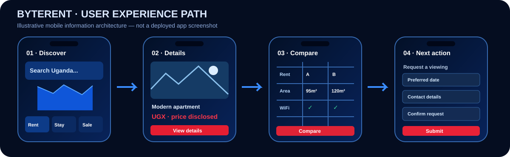
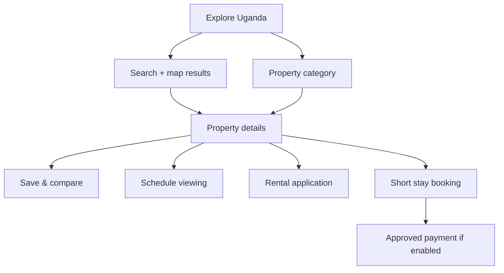

# 🎨 ByteRent Uganda — UI / UX Concept Showcase

[← Project home](./README.md) · [Product modules](./MODULES-AND-JOURNEYS.md)

> [!NOTE]
> **Design concepts, not live product screenshots.** The project owner provided mockups showing a dark navy application, vivid blue location elements, red action buttons, and white text. Prices, properties, endorsements, "verified" marks and ratings shown in reference mockups should not be interpreted as real offers or completed validation.

## Visual identity

| Element | Design treatment |
|---|---|
| Product wordmark | **Byte** in blue / white; **Rent** in red |
| Original brand concept | Cloud, building forms, location pin and house/key motif |
| Tagline | **Beyond Listings. Find Home.** |
| Interface theme | Midnight navy, electric blue, red actions, high-contrast typography |
| Interaction direction | Search-first navigation; strong category hierarchy; readable property cards |

**Landscape and stacked original logo references were supplied privately.** The two inline SVGs below are **vector layout illustrations derived from the supplied visual identity**, not exact replicas of the logo files. The original unmodified images are not yet embedded in this public GitHub page.

## Concept screens supplied

| Screen | Core visual content | Intended purpose |
|---|---|---|
| 🌍 Discover Uganda | Regional map, locations, search and category cards | National discovery rather than Kampala-only browsing |
| 📍 Search & map | Property price markers, filters and list/map switch | Location-led search with visible options |
| 🏠 Rental details | Photos, rooms, facilities, map and landlord actions | Evaluate housing and request viewing |
| 🌱 Land/plot details | Plot image, location, document status, features | Review a proposed land sale carefully |
| 🏨 Lodge details | Images, nightly amount, amenities, check-in rules | Compare short stays |
| 🏢 Commercial spaces | Offices, stores, warehouses and filters | Search business premises |
| ❤️ Saved & Compare | Side-by-side amenities and price | Structured comparison |
| 📋 Rental application | Personal details and document uploads | Submit a controlled application |
| 🗓️ Booking flow | Dates, guest count, price summary and terms | Review before any authorized payment |

### Mobile interaction wireframe — illustrative

## Core screen relationships

### About the visual assets

The original owner-supplied PNG concept images and logo variants are **not included as GitHub binary files in this initial publication**. Only small, original vector illustrations and a written screen walkthrough are published here. The private original files, proposal, SRS and quotation remain outside GitHub.

[← Project home](./README.md)
