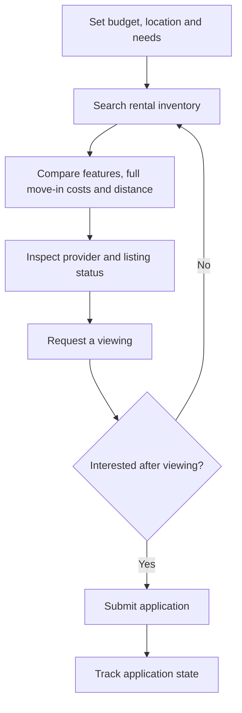
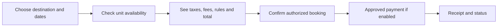
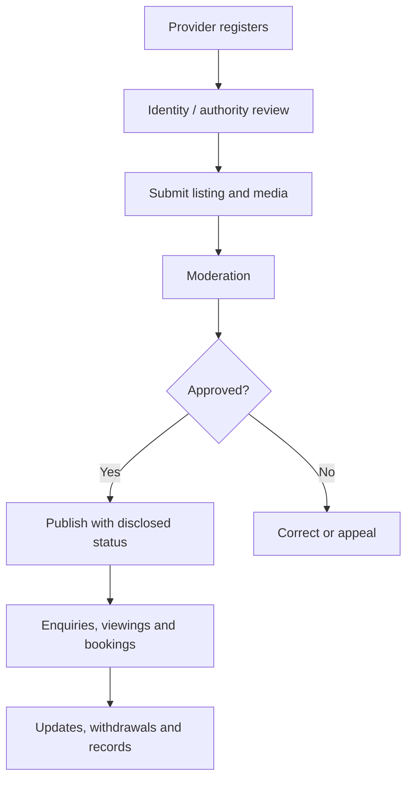

# 🏘️ ByteRent — Product Modules & User Journeys

[← Project home](./README.md) · [Visual showcase](./DESIGN-SHOWCASE.md)

## Core property and place modules

| Module | Planned capabilities | Sample user decision |
|---|---|---|
| 🏠 Residential / hostels | Rent ranges, move-in cost, room features, availability, viewing and application | “Can I afford and visit this apartment?” |
| 🏨 Hotels / lodges / short stay | Dates, guests, duration-specific prices, amenities and booking policies | “Can I book these nights?” |
| 🏡 Houses, land and plots for sale | Listing evidence, offer/enquiry, viewing, due-diligence reminders | “What should I verify before buying?” |
| 🏢 Commercial spaces | Offices, shops, salons, warehouses, premises requirements and provider contact | “Does this space fit my business?” |
| 🚗 Parking | Location, access, availability and provider terms | “Is parking suitable for this trip?” |
| 🗺️ Place intelligence | Regions, maps, work distance, nearby facilities and search filters | “How does this area fit my daily life?” |

## Journey A · Find and apply for a rental

**Public-facing principle:** The application includes sensitive personal data and potentially ID/income evidence. It must never be accessible to unrelated providers, and upload requirements need justified purposes and retention.

## Journey B · Book a short stay

Display date/guest assumptions, room type and cancellation rules before asking for payment. The concept design does not establish a working payment provider.

## Journey C · Consider a land purchase

1. Discover a listed plot or property.
2. Review its location, dimensions and disclosed evidence status.
3. Compare the area with nearby services and access.
4. Request an appointment with the authorized provider.
5. Seek independent professional and legal verification of ownership and boundaries.
6. Proceed only through independently verified lawful channels.

**Important:** A visual “Verified Plot” mockup does not establish a guaranteed land title, legally secure ownership or completed verification.

## Journey D · Provider lifecycle

## Module-wide user interface standards

Every major journey should consider loading, empty results, validation messages, success, failure, cancellations and network interruptions. Search should never invent unavailable properties. Fees should be explicit; private locations and sensitive applicant records should be access-controlled.

[← Project home](./README.md)
