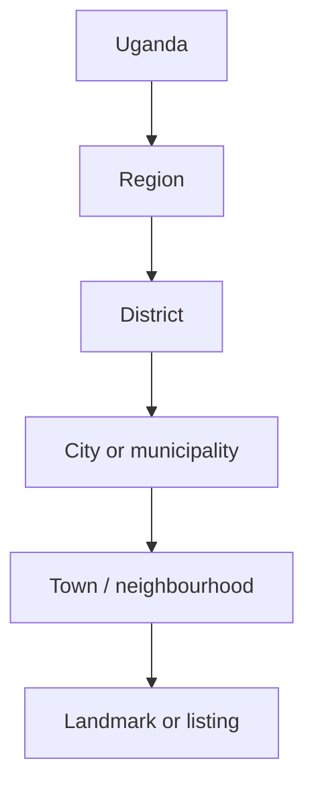

# 🧭 ByteRent Uganda — Product Overview

[← Project home](./README.md) · [Modules](./MODULES-AND-JOURNEYS.md) · [Gantt](./ROADMAP-GANTT.md)

## 1. Vision

**ByteRent is a proposed nationwide property and location platform**, not simply a house-rental directory. The source proposal identifies a fragmented search environment: information spread across personal referrals, signboards, intermediaries and multiple online channels; unclear total costs; outdated listings; and uncertain provider authority.

The proposed response is **Discover → Evaluate → Compare → Act**.

## 2. Public-facing problem-to-solution map

| Search problem | Proposed ByteRent response |
|---|---|
| Listings are scattered | One organized multi-category search system |
| Unclear deposits and fees | Structured cost disclosure and comparisons |
| Location ambiguity | Location hierarchy, maps and nearby places |
| Uncertain listing credibility | Moderation, evidence status, reporting and audit trail |
| Repeated travel for viewings | Requests, appointment status and reminders |
| Informal booking/application process | Traceable application and reservation status |

The source proposal treats these as **product research hypotheses and observations**; no public statistical prevalence or verified outcome is claimed.

## 3. National discovery

The software requirements call for a location hierarchy supporting Uganda-wide expansion, rather than a Kampala-only application. Search concepts cover regions, districts, municipalities, towns, neighbourhoods and landmarks.

Proposed search filters: property purpose, budget, location, property type, date-specific availability and service features. Regional rollout may be staged; geographic inclusion **does not mean property inventory is already available**.

## 4. People and organizations served

- **Seekers:** renters, tenants, buyers, visitors, students and short-stay guests.
- **Providers:** landlords, sellers, hotel and lodge operators, parking and commercial-space providers.
- **Intermediaries:** authorized agents and property managers.
- **Operations:** verification, customer care, finance/payment review and administrators.
- **Oversight:** approved technical support and read-only audit review.

## 5. Boundaries

ByteRent is **not** a substitute for legal due diligence, title searches, official valuation, property inspection or independent confirmation of provider authority. Proposed verification indicators should clearly state what has and has not been checked.

## 6. Why launch in phases?

The original requirements distinguish a **controlled invited pilot** from a scalable production service. Pilot results are meant to validate journeys and operational controls before committing to wider launch. Future integrations require explicit scope, approved provider accounts and appropriate privacy/security review.

[← Project home](./README.md)
