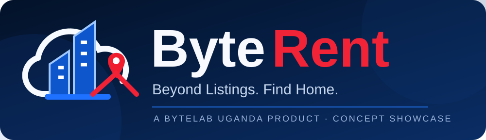
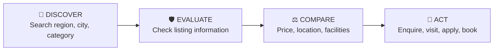
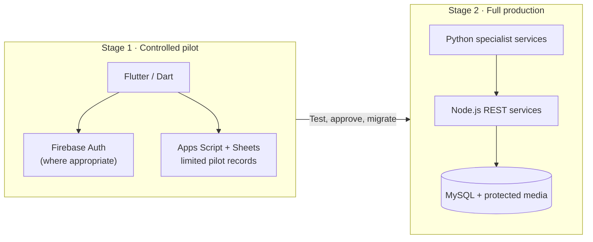

# ByteRent Uganda

### Beyond Listings. Find Home.

**A proposed national property, accommodation and location-discovery platform by ByteLab Uganda Ltd**

> [!IMPORTANT]
> **Concept and design-stage showcase.** These are proposed product capabilities and supplied concept-screen visuals, **not a live listing marketplace**. Sample prices, properties, verification labels and booking screens in the mockups are illustrative—not actual listings, guarantees or completed integrations.

## The idea

**ByteRent Uganda** brings rental homes, hostels, hotels and lodges, property and land sales, commercial premises and parking into one location-aware discovery experience. Users can search by place, needs, price and dates; compare options; inspect disclosed details; and initiate documented enquiries, viewings, applications or bookings.

The public concept follows four connected stages:

## Explore ByteRent

| Section | What you can explore |
|---|---|
| 🧭 **[Product overview](./PRODUCT-OVERVIEW.md)** | Uganda-wide scope, problems, audiences and product principles |
| 🏠 **[Feature and category modules](./MODULES-AND-JOURNEYS.md)** | Rentals, short stays, sales, land, parking, business spaces and user workflows |
| 🏗️ **[Architecture](./ARCHITECTURE.md)** | Controlled pilot vs proposed production technology, roles and information flows |
| 🎨 **[Visual showcase](./DESIGN-SHOWCASE.md)** | Six newly organized original-screen slots with visual journeys and feature traceability; image uploads pending |
| 🛡️ **[Trust, security and acceptance](./TRUST-AND-QUALITY.md)** | Moderation, verification limits, account permissions, payments and quality gates |
| 📅 **[Roadmap and Gantt](./ROADMAP-GANTT.md)** | Indicative 12-month stage-gated rollout and evidence requirements |

## Key experience areas

| Discover | Compare | Engage |
|---|---|---|
| 🏡 Residential rentals / hostels | 📍 Map, proximity & routes | 💬 Enquiry / messaging |
| 🏨 Hotels, lodges & short stays | 💰 Price and fee disclosure | 📅 Viewing or booking |
| 🗺️ Land / properties for sale | 🛡️ Verification status & limits | 📝 Rental applications |
| 🏢 Offices / shops / warehouses | ⭐ Saved listings and comparisons | 🧾 Controlled receipts and records |
| 🚘 Parking spaces | 🏥 Nearby essential services | 🧰 Provider & operational support |

## Proposed delivery architecture

The **pilot technologies are not presented as a permanent large-scale production database or financial ledger**. Production design requires stronger service authorization, migration, monitoring, backups, payment controls and auditability.

**Original-screen assets:** The updated [Design Showcase](./DESIGN-SHOWCASE.md) lays out the exact owner-provided visuals and additional workflows. PNG image uploads are [tracked separately](./assets/ORIGINAL-IMAGES-UPLOAD.md) and are not yet complete.

## Project status

| Dimension | Current public statement |
|---|---|
| Product idea | Defined in source proposal and software requirements |
| User interface | Concept screens supplied; see visual showcase |
| Software implementation | Not verified as complete |
| Launch status | Not represented as a live service |
| Public pricing / contracts | Deliberately excluded; private commercial materials remain private |
| Schedule | 12 months **indicative, relative to authorization**; not a guaranteed delivery date |

## Ownership and contact

**Product owner / developer:** ByteLab Uganda Ltd  
**Project lead:** Code Therapist  
**Product tagline:** Beyond Listings. Find Home.

[ByteLab Uganda](https://bytelabug.com/) · [Code Therapist GitHub](https://github.com/codetherapistpita-oss) · [Portfolio](https://codetherapist.netlify.app/) · [Knowledge Hub](../../README.md)

© ByteLab Uganda Ltd. Public overview rewritten from private source documents. **Original proposal, SRS and commercial quotation have not been uploaded.** Brand names and concept illustrations belong to their respective owners. No source code, production secrets, client records or legal guarantees are disclosed.
