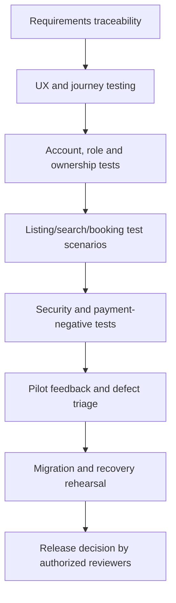

# 🛡️ ByteRent — Trust, Privacy & Quality Approach

[← Project home](./README.md) · [Architecture](./ARCHITECTURE.md)

## Trust is a process, not a badge

The supplied concept screens show blue “verified” labels, seller profiles, pricing panels and secure-booking language. These are **design intentions**. They should be published as mockups, not proof that any displayed property or provider has been checked.

| Risk or concern | Proposed treatment |
|---|---|
| Fake, stale or duplicate listings | Provider review, listing moderation, updates and reporting |
| Misleading cost | Disclose rent separately from deposits, service charges and fees |
| Unverified title/authority | Explicit evidence limits; independent property due diligence |
| Exposed applicant documents | Protected storage, role checks and defined retention |
| Unauthorized account access | Authentication, least privilege, ownership checks and audit logs |
| Payments and refunds | Approved provider integration, traceable states and reconciliation |
| Unsafe maps/location use | Clear location permissions and privacy-aware workplace pin handling |
| Booking or availability errors | Authoritative inventory and visible failure states |

## Quality gates

### Planned test groups

- Registration and profile management, including invalid, locked and expired sessions.
- Property search across regions; zero results and clear filters.
- Listing details, missing attributes, saved searches and comparisons.
- Viewing, application, booking and cancellation state transitions.
- Provider moderation, rejected or expired listings and complaint handling.
- Permissions: seekers cannot see other users' documents; providers cannot see unrelated transactions.
- Payment sandbox success/failure, idempotency and reconciliation (only if formally integrated).
- Data backup, recovery, observability, performance and accessible interface states.

**No measured usability, conversion, financial or security test outcomes are claimed at this project stage.**

## Property due diligence

The platform should not advertise guaranteed title, guaranteed valuation, guaranteed safety or legal advice. A future service must explain what "verified" means and when checks occurred.

## Media and public presentation

The supplied UI visuals demonstrate intended user experience. Labels such as "verified," reviews, ratings, dates, property prices and map pins may be **synthetic presentation data** and are not published as live availability or price quotations.

[← Project home](./README.md)
