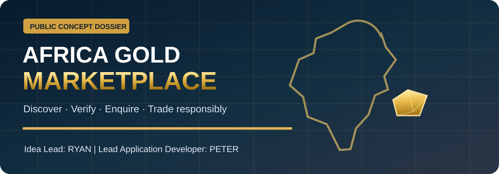

# 🏢 ByteLab Uganda — Project Research & Development Library

### Beyond Code. · Innovation for Africa.

Public technical showcases for proposed products, structured project research, software journeys, design systems and implementation roadmaps.

> [!IMPORTANT]
> This is a **public concept and research showcase**, not a repository of confidential proposals, signed quotations, unreleased source code, trade secrets or client records. Project status is described individually.

## Published projects

| Product | Purpose | Current public status | Documentation |
|---|---|---|---|
| 🏘️ **ByteRent Uganda** | National property, rental, short-stay, land, parking and location discovery | Research and concept designs | **[Explore ByteRent →](./BYTERENT-UGANDA/README.md)** |
| 🛒 **Byte Buz** | Retail POS, inventory, suppliers, branches, analytics and business operations | Requirements and original concept UI; implementation not verified | **[Explore Byte Buz →](./BYTE-BUZ/README.md)** |
| 🪙 **Africa Gold Marketplace** | Proposed compliance-gated gold buyer/seller discovery and quotation platform; Uganda pilot and Africa ambition | Public concept and research; not a trading service | **[Explore Gold Marketplace →](./AFRICA-GOLD-MARKETPLACE/README.md)** |

### ByteRent highlights

[Architecture](./BYTERENT-UGANDA/ARCHITECTURE.md) · [Module journeys](./BYTERENT-UGANDA/MODULES-AND-JOURNEYS.md) · [Visual showcase](./BYTERENT-UGANDA/DESIGN-SHOWCASE.md) · [12-month Gantt](./BYTERENT-UGANDA/ROADMAP-GANTT.md)

### Byte Buz documentation

**[Byte Buz Project Overview](./BYTE-BUZ/README.md)** · [20-screen module map](./BYTE-BUZ/FEATURES-AND-SCREENS.md) · [Architecture](./BYTE-BUZ/SYSTEM-ARCHITECTURE.md) · [UI showcase](./BYTE-BUZ/DESIGN-SHOWCASE.md) · [16-week proposed Gantt](./BYTE-BUZ/GANTT-CHART.md)

> Byte Buz uses a source-derived business-process and technical specification. Its application repositories remain private, and its published interface images are concept references rather than live company metrics.

### 🪙 Africa Gold Marketplace — Ryan & Peter

**[Project Overview](./AFRICA-GOLD-MARKETPLACE/README.md)** · [Business & UX Brief](./AFRICA-GOLD-MARKETPLACE/PROJECT-BRIEF.md) · [Workflows](./AFRICA-GOLD-MARKETPLACE/WORKFLOWS.md) · [System Architecture](./AFRICA-GOLD-MARKETPLACE/ARCHITECTURE.md) · [Gold Compliance](./AFRICA-GOLD-MARKETPLACE/COMPLIANCE-AND-TRUST.md) · [Proposed Roadmap](./AFRICA-GOLD-MARKETPLACE/ROADMAP.md)

**Idea Lead:** Ryan · **Lead Application Developer:** Peter. This is a **concept for lawful screened enquiries**, not a licensed gold merchant, public trading offer or live checkout.

## Publishing standard

Each future ByteLab project will have a public-safe project README, requirements summary, high-level diagrams, user journeys, approved visual previews, a proposed Gantt roadmap and a transparent status statement. Only expressly intended public information goes into this library.

[← Knowledge Hub](../README.md) · [Company website](https://bytelabug.com/) · [Developer profile](https://github.com/codetherapistpita-oss)
