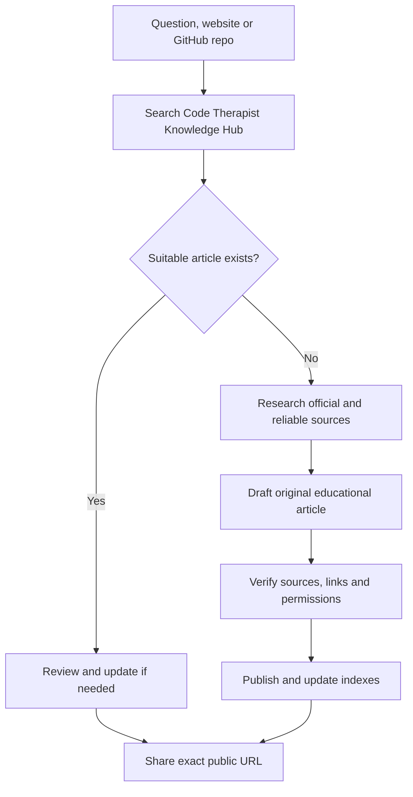

# Code Therapist — Question to Publication Workflow

## Goal

Turn genuine reader questions, reputable technology news, useful websites and interesting GitHub repositories into discoverable, source-checked educational pages without duplicating existing content.

## 1. Question arrives

**Example:** "What is an API?" or "What is MCP?"

1. Search the existing [Knowledge Hub index](./README.md) and known topic directories for the key terms and synonyms.
2. If a suitable page exists, provide its exact link and summarize the relevant answer. Improve the existing article if incomplete.
3. Otherwise, research primary sources and determine the best category, e.g. `14-DATABASES-CLOUD-DEVOPS/BACKEND-ARCHITECTURE` for APIs or `05-AI-AND-LLMS/AI-AGENTS` for MCP.
4. Draft an original guide with **summary → diagram → clear explanation → example → safety notes → sources**.
5. Aim for a useful standalone first edition; mark planned expansions rather than leaving half-written claims.
6. Verify every external link and attribution, publish the Markdown file to GitHub and update its topic index and the main Knowledge Hub index.
7. Reply to the person with the real published URL, a one-paragraph summary and optional related articles.

### Workflow diagram

## 2. Interesting website discovery — "Did you know?"

For a named public website, explain **what it offers, who maintains it, how to use it, any pricing/limits and security considerations**. Link to the verified official website, not suspicious mirrors. Include up to three or four screenshots **when lawfully available and useful**, marked with capture date; website screenshots are not automatically generated by GitHub Markdown.

## 3. Third-party GitHub repository discovery

Review the repository's README, owner, license, project activity, installation requirements and known safety concerns. Provide **links and original commentary**, respect copyright and licenses, and never falsely present a third-party repository as Code Therapist's original work.

## 4. Three daily WhatsApp links

For each link, prepare:
- **Catchy accurate headline** (not clickbait)
- **One or two useful sentences**
- **Real public HTTPS link**
- **Topic and date**
- **Source provenance**

Do not claim to have shared the link in WhatsApp; sharing is the user's action unless an explicitly authorized sending workflow is configured.

## 5. Daily coverage and quality

The editorial goal is **up to 12 category checks or candidate topics**, not an obligation to publish 12 unverified articles. Check duplicates, maintain the publishing register, protect confidential information and avoid publishing false statistics. The 9 AM automation prepares research; the 9 PM automation prompts a review. A task run may be unable to publish if GitHub access is not available in its execution environment.

[← Knowledge Hub](./README.md)
