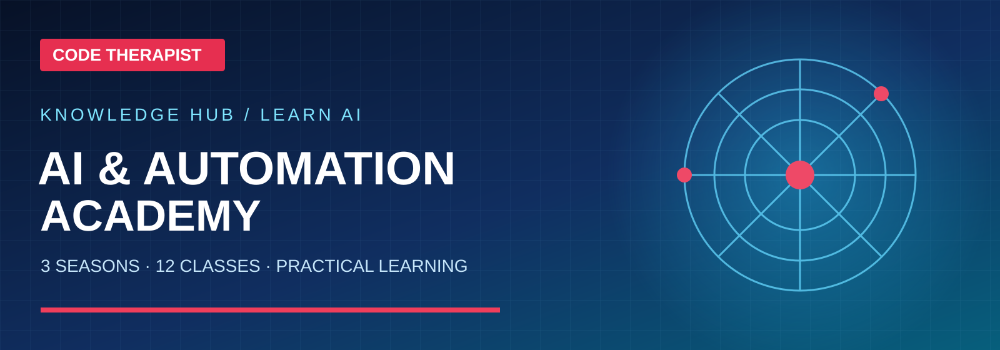
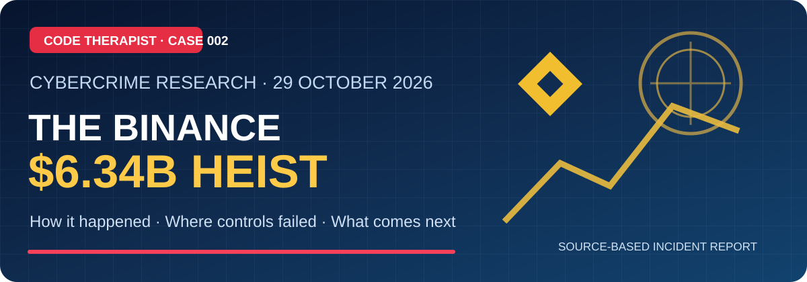

# 🧭 Code Therapist — Knowledge Hub

### Learn • Build • Secure • Explore • Stay Informed

Practical developer resources, free code, safe technology guides, curated news and original technical publications.

---

## 🤖 AI & Automation Academy — 3 Seasons, 15 AI Families

**[Start the AI Academy](./05-AI-AND-LLMS/AI-ACADEMY/README.md)** · [Season One](./05-AI-AND-LLMS/AI-ACADEMY/SEASON-01/README.md) · [Season Two](./05-AI-AND-LLMS/AI-ACADEMY/SEASON-02/README.md) · [Season Three](./05-AI-AND-LLMS/AI-ACADEMY/SEASON-03/README.md) · [15-model directory](./05-AI-AND-LLMS/AI-ACADEMY/MODEL-CATALOG.md) · [Verified AI news](./05-AI-AND-LLMS/AI-ACADEMY/NEWS/README.md)

The original coursework includes 12 lessons, prompt templates, practical labs and model research profiles, with official links and diagrams. All 15 model names refer to **families or model/API products**, not interchangeable versions or a best-model ranking.

## Explore the library

| Category | What you'll find |
| :--- | :--- |
| **[🎓 Developer Academy](./01-DEVELOPER-ACADEMY/README.md)** | Beginner and intermediate learning paths |
| **[🧩 Free Source Code](./02-FREE-SOURCE-CODE/README.md)** | Reusable components and starter projects |
| **[💾 Free Software & Tools](./03-SOFTWARE-AND-TOOLS/README.md)** | Official and open-source tools |
| **[🛡️ Cybersecurity Lab](./04-CYBERSECURITY/README.md)** | Defensive security and authorized labs |
| **[🤖 AI & Automation](./05-AI-AND-LLMS/README.md)** | Models, prompt design and agents |
| **[📰 Technology News](./06-TECH-NEWS/README.md)** | Verified company news and product releases |
| **[📣 Creator & Social Media](./07-SOCIAL-MEDIA/README.md)** | Platform policy and creator changes |
| **[📚 Documentation Library](./08-DOCUMENTATION/README.md)** | PDFs, research and technical guides |
| **[🗓️ Notices & Changelogs](./09-UPDATES-AND-NOTICES/README.md)** | Release notes and announcements |
| **[🔎 Cyber Incidents, Heists & Law](./10-CYBER-INCIDENTS-AND-LAW/README.md)** | Historical incident cases, verified timelines and legal context |
| **[💳 FinTech & Banking](./11-FINTECH-AND-BANKING/README.md)** | Banks, mobile money, payments, financial technology |
| **[🕰️ History of Computing](./12-COMPUTER-HISTORY/README.md)** | Computing generations, pioneers, operating systems and the internet |
| **[🖥️ Hardware & Systems](./13-HARDWARE-AND-SYSTEMS/README.md)** | PCs, GPUs, servers, networking equipment and OS administration |
| **[☁️ Databases, Cloud & DevOps](./14-DATABASES-CLOUD-DEVOPS/README.md)** | SQL, NoSQL, deployment, CI/CD and infrastructure |
| **[🎬 Design & Animation](./15-DESIGN-ANIMATION-GRAPHICS/README.md)** | UI design, CSS motion, 2D/3D and computer graphics |
| **[🧠 Machine Learning & Data](./16-MACHINE-LEARNING-DATA/README.md)** | Data analysis, models, computer vision and evaluation |
| **[🎓 KIU OneCard — IoT Smart Student Card](./17-IOT-SMART-STUDENT-CARD/README.md)** | Final-year IoT prototype design, system architecture, hardware, tests and Gantt chart |
| **[🏢 ByteLab Uganda Product R&D](./18-BYTELAB-PROJECTS/README.md)** | Public-safe product research and architecture showcases, including ByteRent and Byte Buz |
| **[🛒 Byte Buz POS & Business Platform](./18-BYTELAB-PROJECTS/BYTE-BUZ/README.md)** | 20-screen POS design, modular workflows, technical architecture and proposed Gantt |
| **[🪙 Africa Gold Marketplace — Ryan & Peter](./18-BYTELAB-PROJECTS/AFRICA-GOLD-MARKETPLACE/README.md)** | Gold buyer/seller discovery concept, compliant enquiry journeys, architecture, trust and proposed roadmap |

## 🪙 New Africa Gold Marketplace concept — Ryan & Peter

**[Read the Gold Marketplace documentation](./18-BYTELAB-PROJECTS/AFRICA-GOLD-MARKETPLACE/README.md)** · [User journeys](./18-BYTELAB-PROJECTS/AFRICA-GOLD-MARKETPLACE/WORKFLOWS.md) · [Safety & permits](./18-BYTELAB-PROJECTS/AFRICA-GOLD-MARKETPLACE/COMPLIANCE-AND-TRUST.md)

A proposed Uganda-first, Africa-focused gold marketplace website. Published as research and UI architecture only: no unverified seller endorsements, gold stock, payment promises or cross-border authorizations.

## 🔐 New cybercrime investigation — Binance $6.34 billion heist

**[Read the sourced investigation](./10-CYBER-INCIDENTS-AND-LAW/CRYPTO-AND-EXCHANGE-HEISTS/BINANCE-2026-10-29/README.md)** · **[▶️ Watch the original panel](https://youtu.be/dCXlcZmtTbw)** · [Explore all cybercrime research](./10-CYBER-INCIDENTS-AND-LAW/README.md)

The case study distinguishes initial company findings from independent reporting and panel commentary, with a full timeline, security workflows and remaining questions.

## 📺 12 illustrated technology explainers — Episodes 004–015

**[Open the illustrated series and ready-to-record scripts](./07-SOCIAL-MEDIA/YOUTUBE/2026-11-08-TECHNOLOGY-EDUCATION/README.md)** — API, MCP, web development, Python, security, cyber heists, AI agent safety, Google Calendar, YouTube policies, fintech fraud prevention, computing history and Byte Buz.

All posts have landscape visual banners, Mermaid flowcharts, official references and WhatsApp captions. These are published GitHub articles, not uploaded YouTube videos.

## 🌐 Featured series — The Website You Didn't Know

**[Read Parts 001–003 and the YouTube scripts](./07-SOCIAL-MEDIA/YOUTUBE/WEBSITE-YOU-DIDNT-KNOW/README.md)** · [diagrams.net](./07-SOCIAL-MEDIA/YOUTUBE/WEBSITE-YOU-DIDNT-KNOW/PART-001-DIAGRAMS-NET.md) · [Photopea](./07-SOCIAL-MEDIA/YOUTUBE/WEBSITE-YOU-DIDNT-KNOW/PART-002-PHOTOPEA.md) · [Teachable Machine](./07-SOCIAL-MEDIA/YOUTUBE/WEBSITE-YOU-DIDNT-KNOW/PART-003-TEACHABLE-MACHINE.md)

## 🎓 New learning series: Google Workspace

**[Start the Google Workspace course →](./01-DEVELOPER-ACADEMY/GOOGLE-WORKSPACE/README.md)**

| Lesson | Practical focus |
| --- | --- |
| [GW-001](./01-DEVELOPER-ACADEMY/GOOGLE-WORKSPACE/GW-001.md) | Workspace apps and setup |
| [GW-002](./01-DEVELOPER-ACADEMY/GOOGLE-WORKSPACE/GW-002.md) | Gmail and professional email |
| [GW-003](./01-DEVELOPER-ACADEMY/GOOGLE-WORKSPACE/GW-003.md) | Drive, Docs, Sheets and practice budget |

**[Questions, useful websites and repository submissions →](./QUESTION_TO_PUBLICATION_WORKFLOW.md)** — How Code Therapist turns reader requests into sourced articles without duplicates.

## 🔬 New research project — KIU OneCard

**[Read the IoT Smart Student Card project](./17-IOT-SMART-STUDENT-CARD/README.md)** — one NFC card across four simulated campus service terminals, with diagrams, hardware budget and a [proposed 12-week Gantt chart](./17-IOT-SMART-STUDENT-CARD/GANTT-CHART.md).

## 🏘️ ByteLab Product Research — ByteRent Uganda

**[Open ByteRent Uganda's research and visual documentation](./18-BYTELAB-PROJECTS/BYTERENT-UGANDA/README.md)**

Explore the design-stage marketplace concept, modules, trust controls, pilot-to-production architecture, selected branded visuals and indicative 12-month [Gantt chart](./18-BYTELAB-PROJECTS/BYTERENT-UGANDA/ROADMAP-GANTT.md). No confidential source PDFs are hosted here.

## 🛒 Byte Buz — Retail POS & Multi-Branch Management

**[Explore Byte Buz documentation](./18-BYTELAB-PROJECTS/BYTE-BUZ/README.md)** · [UI showcase](./18-BYTELAB-PROJECTS/BYTE-BUZ/DESIGN-SHOWCASE.md) · [Business workflows](./18-BYTELAB-PROJECTS/BYTE-BUZ/WORKFLOWS-AND-CONTROLS.md) · [Gantt plan](./18-BYTELAB-PROJECTS/BYTE-BUZ/GANTT-CHART.md)

The public reference synthesizes the owner's earlier Byte Buz project master brief without exposing private repositories or real business records. Original screenshots will appear in the gallery once their binary files are uploaded.

## Featured public projects

| Project | Repository |
| --- | --- |
| ByteLab Academy | [View source](https://github.com/codetherapistpita-oss/bytelab-academy) |
| Code Therapist Portfolio | [View source](https://github.com/codetherapistpita-oss/codetherapist-portfolio) |
| Code Therapist School | [View repository](https://github.com/codetherapistpita-oss/codetherapistschool) |

## Recent publications

**New · 8 November 2026:** [OWASP Top 10:2025 — A Practical Guide for App Builders](./04-CYBERSECURITY/SECURITY-LABS/2026-11-08-owasp-top-10-2025-for-builders.md) — original defensive guide with a role-authorization example and test matrix.

### 12 newly published guides · 7 November 2026

| Date | Article | Section |
| --- | --- | --- |
| 2026-11-07 | [Accessible CSS Animation](./15-DESIGN-ANIMATION-GRAPHICS/CSS-ANIMATIONS/2026-11-07-css-motion-accessibility.md) | Design |
| 2026-11-07 | [PostgreSQL: First Database Table](./14-DATABASES-CLOUD-DEVOPS/SQL-AND-NOSQL/2026-11-07-postgresql-first-database.md) | Database |
| 2026-11-07 | [Docker Images vs Containers](./14-DATABASES-CLOUD-DEVOPS/CONTAINERS/2026-11-07-docker-image-vs-container.md) | DevOps |
| 2026-11-07 | [ML Training, Validation & Testing](./16-MACHINE-LEARNING-DATA/MODEL-EVALUATION/2026-11-07-ml-training-validation-test.md) | Machine Learning |
| 2026-11-07 | [Ransomware Incident Research](./10-CYBER-INCIDENTS-AND-LAW/RANSOMWARE-AND-FRAUD/2026-11-07-ransomware-incident-explained.md) | Cybersecurity |
| 2026-11-07 | [Bank & Mobile Money Scam Safety](./11-FINTECH-AND-BANKING/FINANCIAL-CYBERSECURITY/2026-11-07-spot-bank-impersonation-scams.md) | FinTech |
| 2026-11-07 | [Computer History 02: Transistors](./12-COMPUTER-HISTORY/COMPUTER-GENERATIONS/2026-11-07-transistors-transform-computers.md) | Computing History |
| 2026-11-07 | [CPU, RAM, SSD & GPU Explained](./13-HARDWARE-AND-SYSTEMS/PC-COMPONENTS/2026-11-07-cpu-ram-ssd-gpu-explained.md) | Hardware |
| 2026-11-07 | [AI Agent Safety Checklist](./05-AI-AND-LLMS/AI-AGENTS/2026-11-07-ai-agent-safety-checklist.md) | AI |
| 2026-11-07 | [WhatsApp Channels vs Groups](./07-SOCIAL-MEDIA/WHATSAPP/2026-11-07-whatsapp-channels-vs-groups.md) | Social Media |
| 2026-11-07 | [JavaScript Form Validation](./01-DEVELOPER-ACADEMY/JAVASCRIPT/2026-11-07-javascript-form-validation.md) | Code Tutorial |
| 2026-11-07 | [Publish with GitHub Pages](./08-DOCUMENTATION/TECHNICAL-NOTES/2026-11-07-github-pages-publishing-basics.md) | Web Publishing |

### Earlier resources

| Date | Resource | Category |
| --- | --- | --- |
| 2026-11-07 | [Protect Your Online Accounts](./04-CYBERSECURITY/SECURITY-LABS/2026-11-07-protect-online-accounts-mfa.md) | Security |
| 2026-11-07 | [Secure GitHub Dependencies with Dependabot](./04-CYBERSECURITY/SECURITY-LABS/2026-11-07-github-dependabot-beginner-guide.md) | GitHub Security |
| 2026-11-07 | [Linux APT: Update vs Upgrade](./03-SOFTWARE-AND-TOOLS/LINUX/2026-11-07-apt-update-vs-upgrade.md) | Linux |
| 2026-11-07 | [Computer History 01: ENIAC](./12-COMPUTER-HISTORY/EARLY-COMPUTING/2026-11-07-eniac-and-electronic-computers.md) | History |
| 2026-11-07 | [Search Visibility for Developers](./06-TECH-NEWS/INNOVATIONS/2026-11-07-search-engine-visibility-for-developers.md) | Web & Search |
| 2026-11-07 | [Responsive Login Form — HTML & CSS](./01-DEVELOPER-ACADEMY/HTML-CSS/login-form/README.md) | Beginner UI code |
| 2026-11-07 | [Microsoft Activation Scripts — Community Reference](https://github.com/codetherapistpita-oss/MICROSOFT_OFFICE_ACTIVATION) | Curated third-party reference |

## How to use the Knowledge Hub

Browse a category, open its topic index, then select an article or source-code project. Articles cite evidence and publication dates; empty topic indexes clearly say **No articles yet**. For incident and law reports, use both **incident date** and **jurisdiction**, and avoid treating allegations as convictions.

The GitHub repository is a public reference library, **not an automatically refreshed news feed**. A searchable public site and scheduled publishing pipeline would be a separate deployment phase.

## Editorial guides and publishing plans

- [How we will publish, improve search visibility and introduce live updates](./PUBLISHING_AND_SEARCH_VISIBILITY.md)
- [Image health report and missing-screen upload guidance](./IMAGE-HEALTH-REPORT.md) — local image audit and automated GitHub validation
- [Cyber incident case-study template](./10-CYBER-INCIDENTS-AND-LAW/INCIDENT_REPORT_TEMPLATE.md)
- [History of Computing — chronological reading path](./12-COMPUTER-HISTORY/HISTORY_READING_PATH.md)

## For contributors and readers

- **Programming resources:** Include source code, a demonstration, prerequisites, instructions, and license information.
- **Software listings:** Link to official project/vendor downloads; avoid repackaged installers, credential tools or dubious activators.
- **Security content:** Use authorized lab environments, emphasize defensive learning, and do not publish stolen secrets or unauthorized access methods.
- **Technical news:** Record the original publication date, reliable source links and what has been independently verified.
- **Third-party projects:** Clearly credit maintainers and preserve license requirements.
- **Editorial workflow:** Use the [article template](./ARTICLE_TEMPLATE.md) for every new publication; add the post to its category and the recent publications index.

> **Publishing status:** The new folders and indexes are live. Empty sections are intentionally marked as awaiting content; listed articles must actually exist.

---

[← Return to Code Therapist's profile](https://github.com/codetherapistpita-oss) · [Portfolio](https://codetherapist.netlify.app/) · [ByteLab Uganda](https://bytelabug.com/)
